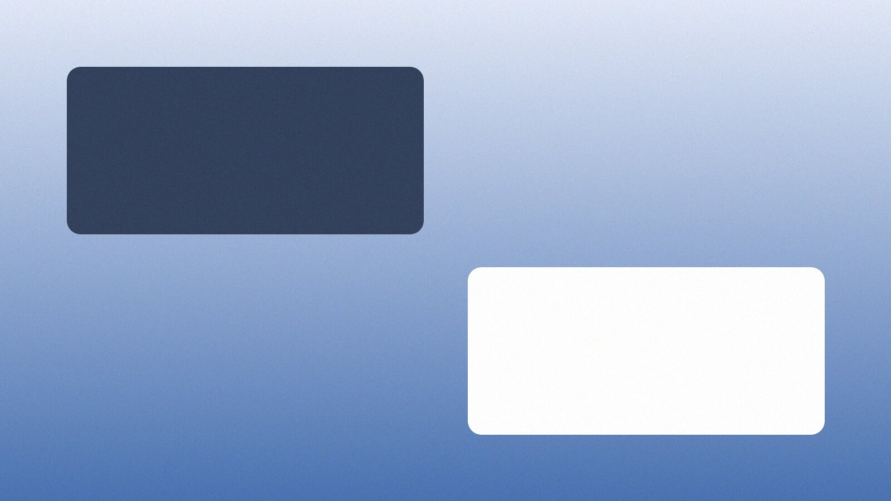

# Diagrams and images

## Shared palette

This diagram sets no colours. The build gives every diagram the same light palette.

```d2
direction: right
author: Author {shape: person}
md: Markdown folder {shape: page}
build: Build CLI
html: One HTML file {shape: page}
author -> md: edits
md -> build
build -> html
```

## Images

The source is a 1600x900 JPEG of 130 KB. When `cwebp` is installed, the build converts a PNG or JPEG over 100 KB to WebP before embedding it.


